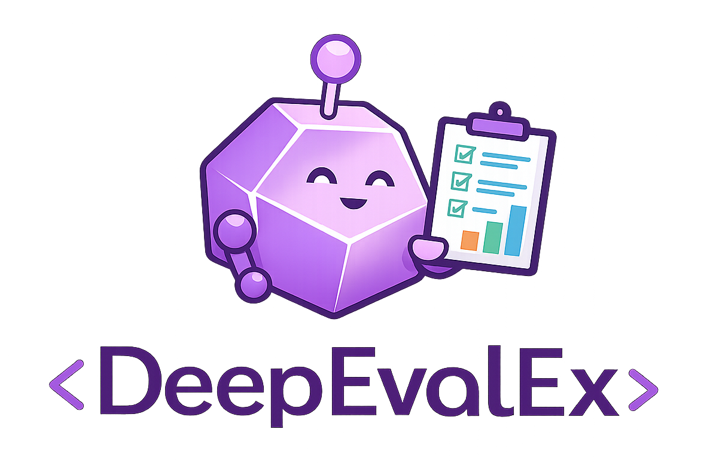

<p align="center">
  
</p>

<p align="center">
  <a href="https://github.com/holsee/deep_eval_ex/actions/workflows/ci.yml"></a>
  <a href="https://hex.pm/packages/deep_eval_ex"></a>
  <a href="https://hexdocs.pm/deep_eval_ex"></a>
  <a href="https://github.com/holsee/deep_eval_ex/blob/main/LICENSE"></a>
</p>

# DeepEvalEx

LLM evaluation framework for Elixir - Idiomatic + Compatible Elixir port of [DeepEval](https://github.com/confident-ai/deepeval).

> **Attribution**: This project is a derivative work of [DeepEval](https://github.com/confident-ai/deepeval)
> by [Confident AI](https://confident-ai.com), licensed under Apache 2.0. The core evaluation
> algorithms, metrics, and prompt templates are derived from the original Python implementation.

## Installation

Add `deep_eval_ex` to your list of dependencies in `mix.exs`:

```elixir
def deps do
  [
    {:deep_eval_ex, "~> 0.1.0"}
  ]
end
```

## Quick Start

```elixir
# Create a test case
test_case = DeepEvalEx.TestCase.new!(
  input: "What is the capital of France?",
  actual_output: "The capital of France is Paris.",
  expected_output: "Paris"
)

# Evaluate with ExactMatch metric
{:ok, result} = DeepEvalEx.Metrics.ExactMatch.measure(test_case)

# Check result
result.score      # => 0.0 (not an exact match)
result.success    # => false
result.reason     # => "The actual and expected outputs are different."
```

## Configuration

Configure your LLM provider in `config/config.exs`:

```elixir
config :deep_eval_ex,
  default_model: {:openai, "gpt-4o-mini"},
  openai_api_key: System.get_env("OPENAI_API_KEY"),
  default_threshold: 0.5
```

## Available Metrics

| Metric | Purpose |
|--------|---------|
| **ExactMatch** | Simple string comparison |
| **GEval** | Flexible criteria-based evaluation using LLM-as-judge |
| **Faithfulness** | RAG: claims supported by retrieval context |
| **Hallucination** | Detects unsupported statements |
| **AnswerRelevancy** | Response relevance to input question |
| **ContextualPrecision** | RAG retrieval ranking quality |
| **ContextualRecall** | RAG coverage of ground truth |
| **ToolCorrectness** | Agent tool calls against the expected tools |

See the [Metrics Overview](wiki/metrics/Overview.md) for detailed documentation on each metric.

## Documentation

| Guide | Description |
|-------|-------------|
| [Quick Start](wiki/guides/Quick-Start.md) | Get up and running in 5 minutes |
| [Configuration](wiki/guides/Configuration.md) | LLM provider setup and options |
| [Metrics Overview](wiki/metrics/Overview.md) | All available metrics explained |
| [ExUnit Integration](wiki/guides/ExUnit-Integration.md) | Test assertions for CI/CD |
| [Custom Metrics](wiki/guides/Custom-Metrics.md) | Build your own evaluation metrics |
| [Telemetry](wiki/guides/Telemetry.md) | Observability and monitoring |

### API Reference

- [TestCase](wiki/api/TestCase.md) - Test case structure
- [Result](wiki/api/Result.md) - Evaluation results
- [Evaluator](wiki/api/Evaluator.md) - Batch evaluation
- [TestRun](wiki/api/TestRun.md) - deepeval-compatible test run export and import
- [LLM Adapters](wiki/api/LLM-Adapters.md) - Provider adapters

### Architecture

- [Architecture Decision Records](docs/adr/README.md) - Design decisions and rationale

## LLM Adapters

DeepEvalEx supports multiple LLM providers:

- **OpenAI** (`:openai`) - GPT-4o, GPT-4o-mini, reasoning models; any
  OpenAI-compatible gateway via `:base_url`, `openai_base_url` config or
  `OPENAI_BASE_URL`
- **Anthropic** (`:anthropic`) - Claude Opus, Sonnet and Haiku via the Messages API
- **Ollama** (`:ollama`) - Local models via Ollama's `/api/chat`
- **Mock** (`:mock`) - Canned responses for tests, no network

Every adapter records token usage and cost on the results.

See [LLM Adapters](wiki/api/LLM-Adapters.md) and [Custom LLM Adapters](wiki/guides/Custom-LLM-Adapters.md) for details.

## Usage with ExUnit

```elixir
defmodule MyApp.LLMTest do
  use ExUnit.Case

  alias DeepEvalEx.{TestCase, Metrics}

  test "LLM generates accurate responses" do
    test_case = TestCase.new!(
      input: "What is 2 + 2?",
      actual_output: get_llm_response("What is 2 + 2?"),
      expected_output: "4"
    )

    {:ok, result} = Metrics.ExactMatch.measure(test_case)
    assert result.success, result.reason
  end
end
```

## Concurrent Evaluation

Evaluate multiple test cases concurrently:

```elixir
test_cases = [
  TestCase.new!(input: "Q1", actual_output: "A1", expected_output: "A1"),
  TestCase.new!(input: "Q2", actual_output: "A2", expected_output: "A2")
]

results = DeepEvalEx.evaluate_batch(test_cases, [Metrics.ExactMatch],
  concurrency: 20
)
```

## Telemetry

DeepEvalEx emits telemetry events for observability:

```elixir
:telemetry.attach("my-handler", [:deep_eval_ex, :metric, :stop], fn _event, measurements, metadata, _config ->
  IO.puts("Metric #{metadata.metric} completed with score #{measurements.score}")
end, nil)
```

See [Telemetry Guide](wiki/guides/Telemetry.md) for all events and integration patterns.

## Migrating from deepeval

DeepEvalEx writes and reads deepeval's `test_run_<timestamp>.json` files, so
existing runs and the tools that read them carry over:

```elixir
# Read a run saved by deepeval's evaluate() (or by DeepEvalEx)
{:ok, test_run} = DeepEvalEx.TestRun.load("eval_results/test_run_20261022_101500.json")
{test_cases, results} = DeepEvalEx.TestRun.to_results(test_run)

# Save new runs in the same format and folder
DeepEvalEx.evaluate_run(test_cases, [DeepEvalEx.Metrics.ExactMatch],
  results_folder: "eval_results"
)
```

`DEEPEVAL_RESULTS_FOLDER` is honoured as in deepeval. Names map directly:
`LLMTestCase` is `DeepEvalEx.TestCase` (snake_case fields, same names),
`MetricData` is `DeepEvalEx.Result` and `evaluate()` is
`DeepEvalEx.evaluate_run/3`. See [TestRun](wiki/api/TestRun.md) for what is
kept on import.

## Development

All tooling runs in the dev container (`.devcontainer/`), which matches the CI
toolchain and has the reference Python deepeval 4.3.1 installed. With the
[Dev Container CLI](https://github.com/devcontainers/cli):

```sh
devcontainer up --workspace-folder .
devcontainer exec --workspace-folder . mix test
```

Provider credentials for live checks go in `.devcontainer/.env` (gitignored;
copy `.devcontainer/.env.example`), which the container loads at creation:
`OPENAI_API_KEY`, `OPENAI_BASE_URL`, `ANTHROPIC_API_KEY`, `ANTHROPIC_BASE_URL`
and `OLLAMA_HOST`. Values may be 1Password secret references
(`op://vault/item/field`); `.devcontainer/resolve-env.sh` resolves them with
`op inject` on the host into the gitignored `.devcontainer/.env.resolved`,
which is what the container loads. Recreate the container after editing it
(`devcontainer up --workspace-folder . --remove-existing-container`). The
default test suite never calls a real LLM (it uses the Mock adapter and
`Req.Test` stubs); only the opt-in live checks below do.

### Live checks

`test/deep_eval_ex/live_test.exs` runs structured output and a full
deepeval-compatible export against the real OpenAI and Anthropic APIs. It is
tagged `:live` and excluded by default; run it explicitly:

```sh
devcontainer exec --workspace-folder . mix test --only live
```

Credentials come from `.devcontainer/.env` as above, as literals or `op://`
references. Each provider runs only when its API key is set; otherwise its
tests are reported as skipped, so a run with one key checks one provider. The
judge model defaults to each adapter's default model; set
`DEEP_EVAL_LIVE_OPENAI_MODEL` and `DEEP_EVAL_LIVE_ANTHROPIC_MODEL` to pick
another, for example the provider-prefixed model IDs a gateway publishes
(`OPENAI_BASE_URL` / `ANTHROPIC_BASE_URL` pointing at the gateway). Live
checks cost real tokens and are not part of the gate.

### Gate

Every change must pass the same checks as CI, inside the container:

```sh
devcontainer exec --workspace-folder . mix format --check-formatted
devcontainer exec --workspace-folder . mix compile --warnings-as-errors
devcontainer exec --workspace-folder . mix credo --strict
devcontainer exec --workspace-folder . mix test --warnings-as-errors
```

CI additionally runs `mix dialyzer`. Build the docs with
`devcontainer exec --workspace-folder . env MIX_ENV=dev mix docs`.

### deepeval parity fixtures

`test/deep_eval_ex/parity_test.exs` compares DeepEvalEx's test run exports
with golden files written by deepeval 4.3.1 under `test/fixtures/deepeval`.
To regenerate them after adding or changing a scenario in
`scripts/parity/generate_fixtures.py`:

```sh
devcontainer exec --workspace-folder . \
  env DEEPEVAL_TELEMETRY_OPT_OUT=1 python3 -I scripts/parity/generate_fixtures.py
devcontainer exec --workspace-folder . mix test test/deep_eval_ex/parity_test.exs
```

A difference is a bug to fix in DeepEvalEx, not something to normalise away;
see the [fixtures README](test/fixtures/deepeval/README.md).

See the [Roadmap](ROADMAP.md) for what is shipped and what is planned.

## License

Apache 2.0 - See [LICENSE](LICENSE) and [NOTICE](NOTICE) for details.

This project is a derivative work of [DeepEval](https://github.com/confident-ai/deepeval)
by Confident AI, also licensed under Apache 2.0.
